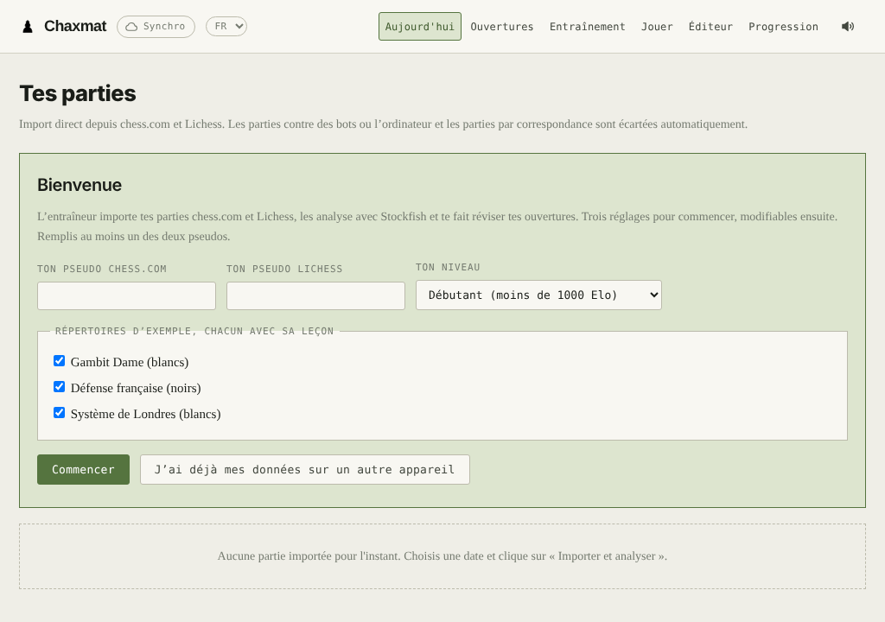
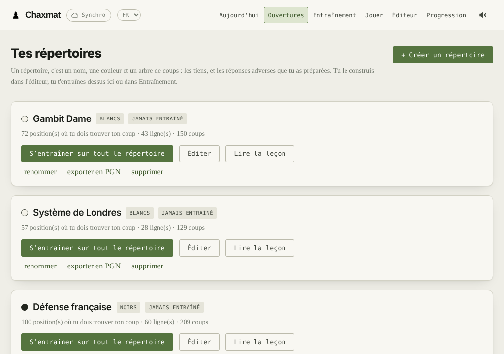

# Entraîneur d'ouvertures

[English](README.md) · **Français**

Une application locale pour progresser aux échecs à partir de ses propres parties
chess.com et Lichess. Elle importe tes parties, les analyse avec Stockfish directement dans le
navigateur, explique chaque coup et te fait réviser tes ouvertures par répétition
espacée. Elle est pensée pour les joueurs débutants et de club, et s'utilise en français
ou en anglais.

Tout tourne sur ta machine : il n'y a ni compte, ni serveur distant, ni publicité.



## Ce qu'elle fait

- **Import et analyse** : tes parties chess.com et Lichess, analysées coup par coup avec Stockfish
  (en WebAssembly, dans le navigateur). Tu obtiens tes gaffes, tes pièces laissées en
  prise, les menaces que tu as gérées et ta précision.
- **Indicateurs du jour**, comparés à ton point de départ et à ta forme des 30 derniers
  jours.
- **Bilan de partie** : chaque coup expliqué en mots (prise, double attaque, clouage…),
  avec les notations de chess.com, le coup qu'il fallait jouer et l'exercice
  « Retrouve le coup ».
- **Répertoires d'ouvertures** : un éditeur avec les coups les plus joués sur Lichess,
  ceux de tes parties et ceux de Stockfish. L'entraînement se fait ligne par ligne, en
  répétition espacée, et tes écarts au répertoire sont repérés dans tes parties.
- **Trois répertoires d'exemple, chacun avec une leçon complète** : Gambit Dame,
  Défense française et Système de Londres. Chaque leçon a ses échiquiers animés, ses
  pièges, ses plans et plus de 100 quiz.
- **Jouer contre le bot** : écris ce que tu veux travailler (« la défense française »,
  « contre la sicilienne »), joue-le contre un bot réglé sur ton niveau, puis reçois un
  bilan centré sur cette ouverture. Demande des tactiques (« les fourchettes et les
  clouages ») : le bot te laisse de temps en temps une occasion à trouver, avec un
  niveau par motif ; demande les finales : il échange les pièces. Le bot fait autant de
  gaffes et d'erreurs qu'un joueur de ton Elo.
- **Bot personnalisé** : il récupère toutes tes parties, fait noter par Stockfish les
  coups possibles de tes adversaires, et apprend comment ils choisissent (prises,
  échecs, roque, s'ils avancent ou reculent, ce qu'ils ratent, quand ils gaffent). Ensuite il joue comme eux, et
  chaque import le réentraîne.
- **Mats et finales** : 35 thèmes (mats de base, roi et pion, règle du carré, Lucena,
  Philidor, dame contre pion, dame contre tour, et des finales avancées jusqu'à 7
  pièces…), chacun une position non triviale tirée au hasard, à gagner ou à annuler
  contre le jeu parfait des tables de finales de Lichess, ou contre Stockfish seul hors
  connexion. Un coup qui laisse filer le gain ou la nulle est signalé tout de suite,
  avec un niveau par thème.
- **Progression** jour par jour et une courbe Elo par site.
- **Réglage de niveau** (débutant, intermédiaire, confirmé), qui ajuste le jugement des
  parties.
- **Deux langues**, français et anglais, leçons comprises : le menu `FR · EN` en haut de
  la page. D'autres langues peuvent s'ajouter (voir plus bas).
- **Appli Android** (WebView) et **synchronisation** facultative entre appareils par
  un dépôt GitHub privé.



## Démarrer

Il faut **Python 3.7** ou plus récent, sans aucun paquet supplémentaire, et un navigateur
récent (Chrome ou Edge 91+, Firefox 98+, Safari 16.4+). La liste complète est dans
[requirements.txt](requirements.txt). Si Python manque, est trop ancien ou incomplet, le
lanceur le dit et indique quoi installer.

| Système | Lancement |
|---|---|
| macOS | double-clic sur `entraineur/Ouvrir l'entraineur.command` |
| Windows | double-clic sur `entraineur/ouvrir-entraineur.bat` |
| Linux | `entraineur/ouvrir-entraineur.sh` |
| Partout | `python3 entraineur/serveur.py` |

Le lanceur démarre un petit serveur local, `serveur.py`, et ouvre le navigateur. La
fenêtre du serveur doit rester ouverte pendant que tu utilises l'application ; la
fermer l'arrête.

Au premier lancement, l'application demande ton pseudo chess.com et/ou Lichess, ton niveau et les
répertoires d'exemple qui t'intéressent. Le [guide](entraineur/GUIDE.md) décrit chaque
onglet.

Tes données sont dans `entraineur/donnees/donnees.json`. Ce dossier est ignoré par git :
il ne part jamais dans le dépôt.

### Mises à jour

Au lancement, si tu es connecté, l'application regarde sur GitHub si une nouvelle
version est publiée (la dernière *release* du dépôt). Si oui, un bandeau te le dit, avec
ses nouveautés :

- **installée avec git** : « Mettre à jour » fait `git pull` dans le dossier, puis la
  page se recharge. Si `serveur.py` a changé, relance l'entraîneur ;
- **téléchargée en ZIP** : « Télécharger » ouvre la release ; remplace le dossier de
  l'application et garde `entraineur/donnees` ;
- **sur Android** : « Mettre à jour » télécharge l'APK de la release, et Android
  demande de confirmer l'installation. Tes données restent.

Tes données ne bougent jamais : `git pull` refuse d'écraser un fichier que tu as
modifié, et le dossier `donnees` est ignoré par git.

## Langue

L'application s'ouvre dans la langue du navigateur ou du téléphone : en français si
c'est du français, en anglais sinon. Le menu `FR · EN`, en haut de la page, la change.
Ce choix est propre à chaque appareil, il n'est pas synchronisé.

Les noms de répertoires sont les tiens : un répertoire d'exemple garde le nom qu'il
avait quand tu l'as ajouté.

### Ajouter une langue

Le texte de référence est le français. Chaque phrase affichée passe par
`tx('phrase en français')`, et chaque langue fournit un dictionnaire
« phrase française → traduction ».

1. Copie `entraineur/app/i18n/en.js` en `i18n/xx.js` (`xx` : le code de la langue,
   `es`, `de`…), change le code et les réglages en tête du fichier (nom, format des
   dates, séparateur décimal, lettres des pièces), puis traduis les valeurs. Les `{0}`,
   `{1}`… sont des valeurs à placer où la langue le veut.
2. Ajoute `<script src="i18n/xx.js"></script>` dans `entraineur/app/index.html`, juste
   après `en.js`. La langue apparaît alors dans le menu.
3. Pour les leçons, copie `lecons.en.js` en `lecons.xx.js`, renomme
   `window.LECONS_EN` en `window.LECONS_XX`, traduis les textes, et ajoute le script
   après `lecons.en.js`. Sans ce fichier, les leçons s'affichent en anglais.
4. Pour l'appli Android, ajoute `android/source/res/values-xx/strings.xml`.

Une phrase oubliée s'affiche en anglais, puis en français : une traduction incomplète
reste utilisable.

## Sur Android

Voir [android/LISEZ-MOI.md](android/LISEZ-MOI.md) : construction de l'APK, installation
et fonctionnement.

## Synchroniser l'ordinateur et le téléphone

Le bouton **Synchro** relie tes appareils par un dépôt GitHub **privé** qui ne contient
que tes données. Les étapes sont détaillées dans l'application :

1. Crée un dépôt privé, par exemple `entraineur-donnees`.
2. Crée un jeton d'accès limité à ce dépôt, avec le droit *Contents : Read and write*.
3. Colle le nom du dépôt et le jeton sur chaque appareil.

Un dépôt public est refusé. **N'utilise jamais pour tes données le dépôt public de
l'application.**

## Analyser ses parties avec Claude

`skills/analyse-partie-echecs/` est un skill pour Claude. Il analyse une partie ou une
séance avec Stockfish, vérifie chaque affirmation, puis produit un rapport HTML avec
échiquiers animés. Pour chaque erreur, le rapport montre le coup qu'il fallait jouer.

- **Claude Code** : copie le dossier `analyse-partie-echecs` dans `.claude/skills/` de
  ton projet, ou dans `~/.claude/skills/` pour tous tes projets.
- **Claude (application ou claude.ai)** : compresse le dossier `analyse-partie-echecs`
  en ZIP. Va ensuite dans *Customize → Skills → + → Create skill → Upload a skill*.
  L'exécution de code doit être activée.

Pour que Claude connaisse ton pseudo, ton niveau et tes habitudes, copie
`profil-exemple.md` en `profil.md` et remplis-le. `profil.md` est ignoré par git.

Les scripts du skill s'utilisent aussi sans Claude. Il faut Python 3.7 ou plus récent,
Stockfish et `pip install -r requirements.txt` :

```
python3 skills/analyse-partie-echecs/scripts/analyser.py partie.pgn <pseudo> analyse.json 22
python3 skills/analyse-partie-echecs/scripts/rapport_partie.py analyse.json commentaires.json partie.html
```

Le format de `commentaires.json` est décrit dans le `SKILL.md`.

## Vie privée

Ce qui sort de ta machine :

- les requêtes du navigateur aux **API publiques de chess.com et de Lichess**, pour
  vérifier tes pseudos et importer tes parties ;
- les requêtes à l'**explorateur d'ouvertures de Lichess**, si tu t'y connectes, sans
  aucun droit sur ton compte ;
- l'envoi de tes données à **GitHub**, si tu actives la synchronisation ;
- au lancement, une requête à l'**API de GitHub** pour savoir si une nouvelle version
  est publiée (au plus une par heure ; elle n'envoie rien de toi) ;
- le chargement des **polices Google Fonts**.

Le serveur local refuse toute requête qui ne vient pas de la page elle-même.

## Contenu du dépôt

```
entraineur/
  app/            l'application web (HTML, CSS, JavaScript, Stockfish en WebAssembly)
    i18n/         les traductions de l'interface (i18n.js, en.js)
    lecons.js     les leçons en français ; lecons.en.js en anglais
  serveur.py      le serveur local (Python standard)
  GUIDE.md        le guide d'utilisation
  Ouvrir l'entraineur.command, ouvrir-entraineur.sh, ouvrir-entraineur.bat
android/          l'appli Android : sources et script de construction
skills/analyse-partie-echecs/
  SKILL.md        le skill Claude
  scripts/        analyse Stockfish et gabarits de rapports HTML
docs/             captures d'écran
requirements.txt  les dépendances (paquets pip, puis tout le reste)
```

## Licence

GNU GPL version 3 : voir [LICENSE](LICENSE). Les composants tiers (Stockfish.js,
chess.js, les pièces « cburnett »…) et leurs licences sont listés dans
[TIERS.md](TIERS.md).

Projet personnel et gratuit, fourni sans garantie. Il n'est lié ni à chess.com, ni à
Lichess, ni à Anthropic.
