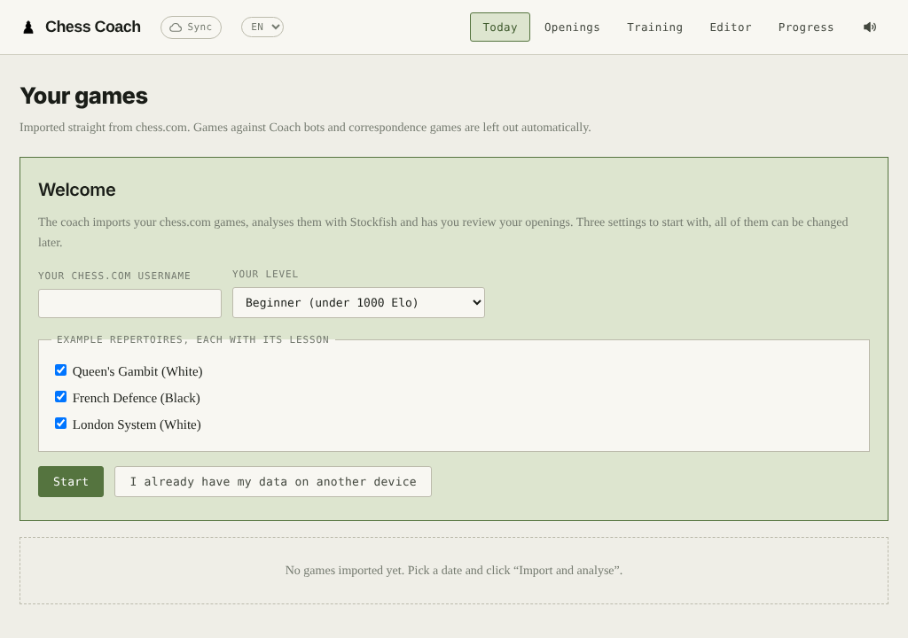
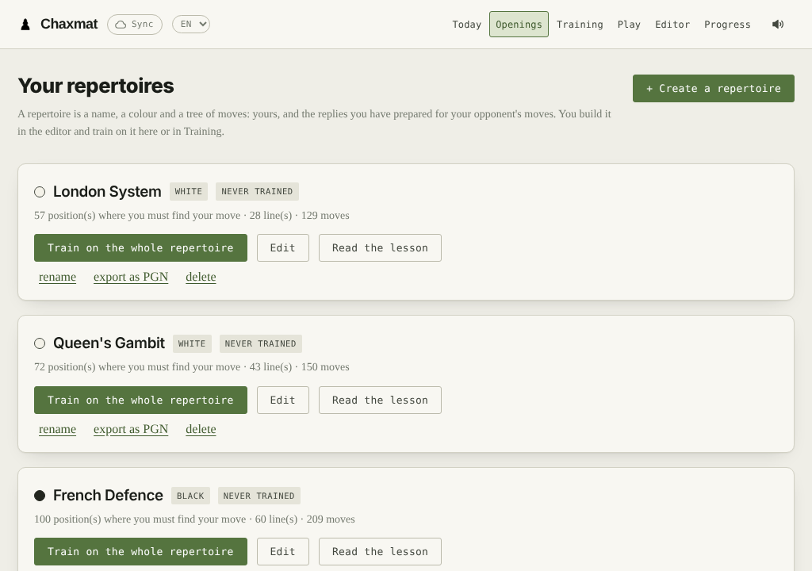

# Chaxmat

**English** · [Français](README.fr.md) · [Website](https://amaurycu.github.io/chaxmat/)

**Chaxmat** is a free, open-source chess trainer for desktop and Android. It is a local
app to improve at chess from your own chess.com and Lichess games. It imports your
games, analyses them with Stockfish right in the browser, explains every move and has
you review your openings with spaced repetition. It is designed for beginners and club
players, and works in English or French.

Everything runs on your computer: no account, no remote server, no ads.



## What it does

- **Import and analysis**: your chess.com and Lichess games, analysed move by move with Stockfish
  (WebAssembly, in the browser). You get your blunders, the pieces you left hanging, the
  threats you handled and your accuracy.
- **Daily indicators**, compared with your starting point and with your form over the
  last 30 days.
- **Game review**: every move explained in words (capture, double attack, pin…), with
  chess.com-style move ratings, the move you should have played and a “Find the move”
  exercise.
- **Opening repertoires**: an editor showing the most played moves on Lichess, the
  moves from your games and Stockfish's suggestions. Training goes line by line, with
  spaced repetition, and your deviations from the repertoire are spotted in your games.
- **Three example repertoires, each with a full lesson**: Queen's Gambit, French Defence
  and London System. Each lesson has animated boards, traps, plans and more than 100
  quizzes.
- **Play against the bot**: write what you want to work on (“the French Defence”,
  “against the Sicilian”), play it against a bot set to your level, then get a review
  focused on that opening. Ask for tactics (“forks and pins”) and the bot now and then
  leaves you a chance to find, with a level per motif; ask for endgames and it trades
  down. The bot makes as many blunders and mistakes as a player of your rating.
- **Personal bot**: it fetches all your games, has Stockfish score your opponents’
  possible moves, and learns how they choose (captures, checks, castling, whether they
  advance or retreat, what they miss, when they blunder). Then it plays like them, and
  every import retrains it.
- **Checkmates and endgames**: 35 themes (basic mates, king and pawn, the square,
  Lucena, Philidor, queen against pawn, queen against rook, and advanced endings up to
  7 pieces…), each a non-trivial random position to win or to hold against perfect
  play from the Lichess tablebases, or against Stockfish alone when offline. A move
  that throws away the win or the draw is flagged at once, with a level per theme.
- **Progress** day by day and one Elo curve per site.
- **Level setting** (beginner, intermediate, advanced), which adjusts how games are
  judged.
- **Two languages**, English and French, lessons included: the `FR · EN` menu at the top
  of the page. More languages can be added (see below).
- **Android app** (WebView) and optional **sync** between devices through a private
  GitHub repository.



## Getting started

Get the app: the ZIP or the Android APK of the
[latest release](https://github.com/AMAURYCU/chaxmat/releases/latest), or a git clone,
which then updates in one click:

```
git clone https://github.com/AMAURYCU/chaxmat.git
```

You need **Python 3.7** or later, with no extra package, and a recent browser (Chrome or
Edge 91+, Firefox 98+, Safari 16.4+). The full list is in [requirements.txt](requirements.txt).
If Python is missing, too old or incomplete, the launcher says so and tells you what to
install.

| System | How to start |
|---|---|
| macOS | double-click `entraineur/Ouvrir l'entraineur.command` |
| Windows | double-click `entraineur/ouvrir-entraineur.bat` |
| Linux | `entraineur/ouvrir-entraineur.sh` |
| Anywhere | `python3 entraineur/serveur.py` |

The launcher starts a small local server, `serveur.py`, and opens the browser. Keep the
server window open while you use the app; closing it stops the server.

On first launch, the app asks for your chess.com and/or Lichess username, your level and the example
repertoires you want. The [user guide](entraineur/GUIDE.md) (in French) describes each
tab.

Your data lives in `entraineur/donnees/donnees.json`. That folder is ignored by git: it
never ends up in the repository.

### Updates

On launch, if you are online, the app asks GitHub whether a new version has been
published (the repository's latest *release*). If so, a banner says so, with what's new:

- **installed with git**: "Update" runs `git pull` in the folder, then the page
  reloads. If `serveur.py` changed, start the coach again;
- **downloaded as a ZIP**: "Download" opens the release; replace the app folder and keep
  `entraineur/donnees`;
- **on Android**: "Update" downloads the release's APK, and Android asks you to confirm
  the installation. Your data stays.

Your data never moves: `git pull` refuses to overwrite a file you changed, and the
`donnees` folder is ignored by git.

## Language

The app opens in the language of your browser or phone: French if it is French, English
otherwise. The `FR · EN` menu at the top of the page switches it. The choice belongs to
each device and is not synced.

Repertoire names are yours: an example repertoire keeps the name it had when you added
it.

### Adding a language

The reference text is French. Every displayed sentence goes through
`tx('French sentence')`, and each language provides a dictionary
“French sentence → translation”.

1. Copy `entraineur/app/i18n/en.js` to `i18n/xx.js` (`xx` being the language code, `es`,
   `de`…), change the code and the settings at the top of the file (name, date format,
   decimal separator, piece letters), then translate the values. `{0}`, `{1}`… are values
   to place wherever the language needs them.
2. Add `<script src="i18n/xx.js"></script>` to `entraineur/app/index.html`, right after
   `en.js`. The language then shows up in the menu.
3. For the lessons, copy `lecons.en.js` to `lecons.xx.js`, rename `window.LECONS_EN` to
   `window.LECONS_XX`, translate the texts, and add the script after `lecons.en.js`.
   Without that file, lessons are shown in English.
4. For the Android app, add `android/source/res/values-xx/strings.xml`.

A missing sentence is shown in English, then in French: an incomplete translation is
still usable.

## On Android

The app is wrapped in a WebView that replaces the local server: no server or terminal
to start, the icon opens the app directly. To build the APK (on Linux):

```
sudo apt install openjdk-17-jdk-headless aapt dalvik-exchange zipalign apksigner android-sdk-platform-23
cd android && ./construire_apk.sh      # writes Chaxmat.apk in this folder
```

The first run creates the signing key `cle/entraineur.p12` and asks for its password (or
reads it from the `MDP_CLE` variable). **Keep that key and never publish it**: Android
only accepts an update signed with the same key. The APK contains no data. Details, in
French: [android/LISEZ-MOI.md](android/LISEZ-MOI.md).

## Syncing computer and phone

The **Sync** button links your devices through a **private** GitHub repository that
contains only your data. The steps are detailed in the app:

1. Create a private repository, for example `entraineur-donnees`.
2. Create an access token limited to that repository, with the *Contents: Read and
   write* permission.
3. Paste the repository name and the token on each device.

A public repository is refused. **Never use the app's public repository for your
data.**

## Analysing your games with Claude

`skills/analyse-partie-echecs/` is a skill for Claude (written in French). It analyses
a game or a session with Stockfish, checks every claim, then produces an HTML report
with animated boards. For each mistake, the report shows the move you should have
played.

- **Claude Code**: copy the `analyse-partie-echecs` folder into `.claude/skills/` in your
  project, or into `~/.claude/skills/` for all your projects.
- **Claude (app or claude.ai)**: zip the `analyse-partie-echecs` folder, then go to
  *Customize → Skills → + → Create skill → Upload a skill*. Code execution must be
  enabled.

To let Claude know your username, level and habits, copy `profil-exemple.md` to
`profil.md` and fill it in. `profil.md` is ignored by git.

The skill's scripts also work without Claude. You need Python 3.7 or later, Stockfish and
`pip install -r requirements.txt`:

```
python3 skills/analyse-partie-echecs/scripts/analyser.py game.pgn <username> analysis.json 22
python3 skills/analyse-partie-echecs/scripts/rapport_partie.py analysis.json comments.json game.html
```

The format of the comments file is described in `SKILL.md`.

## Privacy

What leaves your computer:

- the browser's requests to the **public chess.com and Lichess APIs**, to check your
  usernames and import your games;
- requests to the **Lichess opening explorer**, if you log in to it, with no rights on
  your account;
- your data sent to **GitHub**, if you turn on sync;
- on launch, one request to the **GitHub API** to check whether a new version is out (at
  most once an hour; it sends nothing about you);
- loading the **Google Fonts**.

The local server refuses any request that does not come from the page itself.

## Repository contents

```
entraineur/
  app/            the web app (HTML, CSS, JavaScript, Stockfish in WebAssembly)
    i18n/         interface translations (i18n.js, en.js)
    lecons.js     lessons in French; lecons.en.js in English
  serveur.py      the local server (standard Python)
  GUIDE.md        the user guide (French)
  Ouvrir l'entraineur.command, ouvrir-entraineur.sh, ouvrir-entraineur.bat
android/          the Android app: sources and build script
skills/analyse-partie-echecs/
  SKILL.md        the Claude skill
  scripts/        Stockfish analysis and HTML report templates
docs/             the website (GitHub Pages) and screenshots
requirements.txt  dependencies (pip packages, then everything else)
```

## Licence

GNU GPL version 3: see [LICENSE](LICENSE). Third-party components (Stockfish.js,
chess.js, the “cburnett” pieces…) and their licences are listed in
[TIERS.md](TIERS.md).

A free personal project, provided without warranty. It is not affiliated with
chess.com, Lichess or Anthropic.
